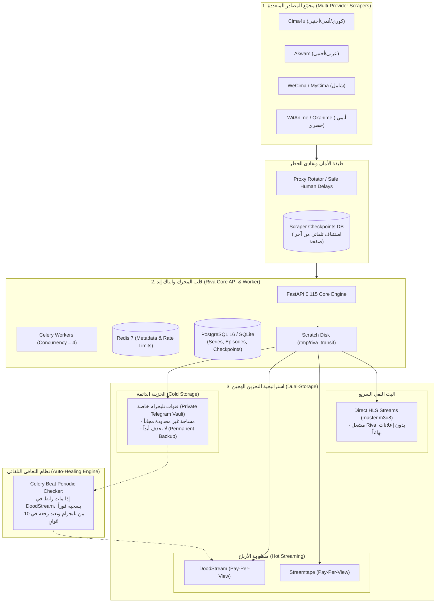
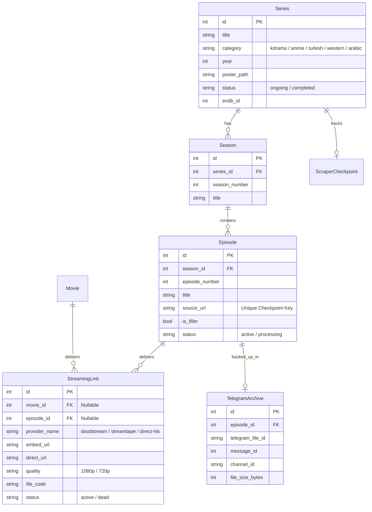

# خطة الباك إند الشاملة ومعمارية منصة Riva VOD Engine

وثيقة التصميم الهندسي وخطة العمل لبناء محرك بث وتوزيع فيديو متكامل، يتفوق على المواقع التقليدية (مثل Egybest) في حجم المكتبة وسرعة التحديث وجودة المشاهدة، مع تأمين كامل ضد حظر الـ IP وفقدان الملفات.

---

## 1. الرؤية الهندسية ومخطط المعمارية الشامل (System Architecture)

يعتمد النظام على **3 ركائز رئيسية**:
1. **مصادر متعددة قابلة للتبديل (Scrapers Pool)** لتجنب الاعتماد على موقع واحد.
2. **تخزين هجين ذكي**: تليجرام كخزينة دائمة لا تُحذف + DoodStream/Streamtape لجني الأرباح.
3. **مشغل متعدد الخيارات**: بث مباشر نقي (HLS) بدون إعلانات + سيرفرات بديلة.



---

## 2. هيكل البيانات الموحد (Unified Database Schema)

النظام مصمم لتوحيد جميع المصادر في نموذج مركزي نظيف:



---

## 3. خطة التعامل مع حظر الـ IP (Anti-Ban & Stealth Scraping)

لمنع تكرار حظر الـ IP الذي حدث أثناء التجارب:
1. **الـ Safe Random Delays**:
   * وضع فاصل زمني عشوائي بين كل طلب وآخر (`random.uniform(2.0, 4.5)` ثانية) مع رأس متصفح كامل (`User-Agent`, `Sec-Ch-Ua`, `Accept-Language`).
2. **نظام استئناف العمل (Checkpoints Resumption Engine)**:
   * حفظ رقم الصفحة الحالية وعدد الحلقات المسحوبة في جدول `scraper_checkpoints`.
   * في حال توقف السحب أو حدث حظر مؤقت، ينام الاسكرابر ويستأنف فوراً من نفس الصفحة والمسلسل دون تكرار أي محتوى تم إنجازه.
3. **دعم البروكسي الدوار (Rotating Proxy)**:
   * إضافة متغير `SCRAPER_PROXY_URL` في إعدادات الباك إند، لتمرير الطلبات عبر شبكات بروكسي دوارة في حال سحب آلاف الصفحات دفعة واحدة.

---

## 4. خطة التخزين في تليجرام (Telegram Master Vault)

### لماذا تليجرام هو صمام الأمان الحقيقي للمشروع؟
* **المشكلة في مواقع الرفع (DoodStream / Streamtape)**: تحذف الملفات بعد 30 إلى 60 يوماً إذا لم تحصل على مشاهدات مستمرة، بالإضافة لبلاغات حقوق الملكية.
* **الحل عبر تليجرام**:
  1. إنشاء **قناة تليجرام خاصة (Private Channel)** مغلقة لا يدخلها أي شخص.
  2. يقوم بوت الباك إند برفع نسخة الفيديو الأصلية إلى القناة وتخزين الـ `telegram_file_id`.
  3. **النتيجة**: مكتبة سحابية كاملة مجانية للأبد لا يمكن لأحد حذفها أو الوصول إليها.
  4. **محرك التعافي التلقائي (Self-Healing)**: إذا تعطل أو حُذف رابط حلقة من DoodStream أو Streamtape، يسحب السيرفر الحلقة فوراً من تليجرام في ثوانٍ ويعيد رفعها برابط جديد دون أن يشعر الزائر بأي عطل.

---

## 5. خطة مراحل التنفيذ (Implementation Roadmap)

| المرحلة | المهام المنجزة والمخططة | الحالة |
| :--- | :--- | :--- |
| **المرحلة 1: المعمارية الأساسية** | - تصميم جداول المسلسلات والمواسم والحلقات.<br>- بناء اسكرابر Cima4u الذكي مع فك تشفير HLS.<br>- إثبات الرفع الحقيقي إلى DoodStream. | **تمت بنجاح ✅** |
| **المرحلة 2: حماية الأمان والمصادر المتعددة** | - دمج فواصل الأمان (Safe Human Delays) لمنع حظر الـ IP.<br>- بناء اسكرابر بديل (Akwam / WeCima) داخل `worker/scrapers/`.<br>- نظام التبديل الآلي بين المواقع عند تعطل أحدها. | **جاهزة للتنفيذ 🚀** |
| **المرحلة 3: تكامل خزينة تليجرام** | - إنشاء وحدة `worker/telegram_vault.py` للرفع الآلي للقناة الخاصة.<br>- ربط نظام التعافي التلقائي (Auto-Healer) لإعادة توليد الروابط الميتة. | **مجدولة للتنفيذ ⏳** |
| **المرحلة 4: النشر على سيرفر Hostinger VPS** | - تشغيل الحاويات عبر Docker Compose على سيرفر هوستنجر.<br>- تشغيل العمال (Celery Workers) لجمع المحتوى بسرعة 1Gbps في الخلفية 24/7. | **جاهزة عند توفر السيرفر 🌐** |

---

## 6. أوامر التشغيل والاستخدام

```bash
# 1. تهيئة جداول قاعدة البيانات
python init_db.py

# 2. تشغيل سحب المسلسلات الكورية والآسيوية (استئناف تلقائي من آخر صفحة)
python -m worker.scrapers.cima4u_crawler asian-series 5

# 3. تشغيل سحب مسلسلات الأنمي
python -m worker.scrapers.cima4u_crawler anime-series 5

# 4. تشغيل سحب كافة الأقسام تباعاً
python -m worker.scrapers.cima4u_crawler --all 5

# 5. تشغيل سيرفر الـ API لمتابعة البيانات
uvicorn app.main:app --host 0.0.0.0 --port 8000 --reload
```
