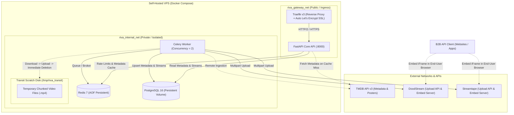

# Riva VOD B2B SaaS Architecture & Engine

High-performance, self-hosted B2B Video-on-Demand (VOD) SaaS engine delivering TMDB movie metadata and active streaming embed links from external cyberlockers (DoodStream, Streamtape).

---

## 1. System Architecture Diagram



---

## 2. Infrastructure Setup & Quick Start

### 1. Copy Environment Configuration
```bash
cp .env.example .env
nano .env
```
Ensure you provide your domain name (pointed to the VPS IP), email for Let's Encrypt SSL, and your TMDB and Cyberlocker API credentials.

### 2. Launch Stack via Docker Compose
```bash
docker compose up -d --build
```

### 3. Verify Health & Provision Initial API Key
```bash
# Check service health
curl https://api.yourdomain.com/health

# Generate an enterprise API key for a client
docker compose exec api python cli_seed.py client@company.com enterprise
```

---

## 3. Core API Endpoints

### Headers:
- `X-API-Key`: `riva_live_...`

### Primary Endpoints:
- `GET /v1/movies/{movie_id}`: Retrieves cached TMDB metadata and active cyberlocker streaming links.
- `GET /v1/movies/trending`: Retrieves daily trending movies with stream availability indicators.
- `GET /v1/series`: List series with category filter (`kdrama`, `anime`, `asian`, `turkish`, `western`, `arabic`), search, and pagination.
- `GET /v1/series/{series_id}`: Full series details with seasons and episodes hierarchy.
- `GET /v1/episodes/{episode_id}`: Episode streaming servers and direct playback links.
- `GET /v1/crawler/status`: Live checkpoint progress for automated category scraping.
- `POST /v1/admin/api-keys`: Admin endpoint to provision keys with custom tier quotas.

---

## 4. Automated Multi-Provider Scraper Engine

Riva includes a high-speed, resumable scraper engine with anti-ban protections:
```bash
# Crawl Korean & Asian Series with automatic resume
python -m worker.scrapers.cima4u_crawler asian-series 5

# Crawl Anime Series
python -m worker.scrapers.cima4u_crawler anime-series 5

# Crawl all categories sequentially
python -m worker.scrapers.cima4u_crawler --all 5
```

For the complete architectural design, dual-storage strategy (Telegram Vault + DoodStream), and Hostinger VPS deployment roadmap, see:
👉 **[BACKEND_MASTER_PLAN.md](file:///c:/Users/pc/Desktop/riva/BACKEND_MASTER_PLAN.md)**

